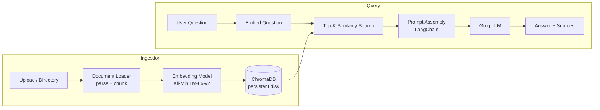

# RAG System

**A production-deployed Retrieval-Augmented Generation (RAG) service that answers questions grounded in your own documents, with source attribution.**

[](https://rag-system-1rui.onrender.com/)
[](https://rag-system-1rui.onrender.com/docs)


**Live service:** https://rag-system-1rui.onrender.com/
**Interactive API docs:** https://rag-system-1rui.onrender.com/docs

---

## Overview

Large language models answer from their training data, not from *your* data. This project closes that gap. It ingests documents, splits them into semantically searchable chunks, stores their embeddings in a vector database, and at query time retrieves the most relevant passages to ground the LLM's answer, returning the sources it used.

It ships as both a **REST API** (FastAPI) and a **CLI** (Click + Rich), and is deployed on **Render** with a persistent disk so indexed knowledge survives restarts and redeploys.

### Key features

| Capability | Detail |
|---|---|
| Multi-format ingestion | PDF, TXT, DOCX, Markdown, CSV, HTML |
| Semantic retrieval | Dense similarity search with `sentence-transformers` embeddings |
| Fast generation | Groq-hosted LLM inference |
| Source attribution | Every answer can return the chunks and documents it was based on |
| Dual interface | REST API with auto-generated Swagger docs, plus a rich terminal CLI |
| Admin-protected writes | Ingestion and reset endpoints require an `X-Admin-Key` header |
| Config-driven | All behavior tunable through environment variables, no code changes |
| Persistent storage | ChromaDB on a Render persistent disk |
| Local embeddings | No embedding API key or per-call cost |

---

## Architecture



**Ingestion:** files are parsed by format, split into overlapping chunks (default 1000 characters, 200 overlap), embedded locally, and persisted in ChromaDB.

**Query:** the question is embedded, the top-K most similar chunks are retrieved (default 5), assembled into a prompt through a LangChain chain, and sent to a Groq-hosted LLM. The response includes the answer and, optionally, the supporting sources.

### Tech stack

| Layer | Technology |
|---|---|
| API server | FastAPI + Uvicorn |
| Orchestration | LangChain |
| LLM inference | Groq |
| Embeddings | HuggingFace `all-MiniLM-L6-v2` (runs locally) |
| Vector database | ChromaDB |
| CLI | Click + Rich |
| Configuration | Pydantic Settings |
| Hosting | Render (web service + persistent disk) |

---

## Project structure

```
RAG_SYSTEM/
├── rag_system/
│   ├── __init__.py
│   ├── __main__.py          # python -m rag_system entry point
│   ├── api.py               # FastAPI REST server
│   ├── cli.py               # Click CLI with Rich output
│   ├── config.py            # Pydantic settings (env / .env)
│   ├── document_loader.py   # Multi-format loading and chunking
│   ├── embeddings.py        # HuggingFace embedding model
│   ├── logger.py            # Structured logging
│   ├── pipeline.py          # High-level orchestration
│   ├── rag_chain.py         # LangChain RAG chain with Groq
│   └── vector_store.py      # ChromaDB operations
├── .env.example             # Configuration template
├── render.yaml              # Render Blueprint (IaC)
├── pyproject.toml           # Dependencies and project metadata
└── README.md
```

The codebase separates concerns by module: loading, embedding, storage, chain logic, and interfaces (API/CLI) are independent, and `pipeline.py` composes them. Both interfaces reuse the same pipeline.

---

## Try the live API

Base URL: `https://rag-system-1rui.onrender.com`

```bash
# Health check
curl https://rag-system-1rui.onrender.com/health

# Vector store statistics
curl https://rag-system-1rui.onrender.com/api/status

# Ask a question (with sources)
curl -X POST https://rag-system-1rui.onrender.com/api/query \
  -H "Content-Type: application/json" \
  -d '{"question": "What is this about?", "return_sources": true}'
```

Or explore interactively in Swagger UI: https://rag-system-1rui.onrender.com/docs

---

## API reference

| Method | Endpoint | Auth | Description |
|---|---|---|---|
| `GET` | `/health` | None | Health check |
| `POST` | `/api/ingest` | `X-Admin-Key` | Upload and ingest a file (10 MB max) |
| `POST` | `/api/ingest/directory` | `X-Admin-Key` | Ingest a directory on the server |
| `POST` | `/api/query` | None | Ask a question |
| `GET` | `/api/status` | None | Vector store statistics |
| `DELETE` | `/api/reset` | `X-Admin-Key` | Clear all documents |

```bash
# Upload a document (admin only)
curl -X POST https://rag-system-1rui.onrender.com/api/ingest \
  -H "X-Admin-Key: <your-admin-key>" \
  -F "file=@document.pdf"
```

---

## Run locally

**Prerequisites:** Python 3.x and a free [Groq API key](https://console.groq.com/keys).

```bash
# 1. Clone and create a virtual environment
git clone https://github.com/balaravi444/RAG_SYSTEM.git
cd RAG_SYSTEM
python -m venv .venv

# Windows
.venv\Scripts\activate
# macOS / Linux
source .venv/bin/activate

# 2. Install
pip install -e .

# 3. Configure
cp .env.example .env
# Edit .env: set GROQ_API_KEY and a long, random ADMIN_API_KEY
```

### Use the CLI

```bash
rag ingest ./my_docs/                  # ingest a file or directory (recursive)
rag ask "What are the conclusions?"    # single question
rag ask "Summarize the findings" --sources -k 10
rag chat                               # interactive session
rag status                             # vector store stats
rag reset                              # clear the knowledge base
```

### Run the API

```bash
python -m rag_system
# or
uvicorn rag_system.api:app --reload --port 8000
```

Swagger docs: http://localhost:8000/docs

---

## Configuration

All settings are environment variables (or entries in `.env`).

| Variable | Default | Description |
|---|---|---|
| `GROQ_API_KEY` | required | Groq API key |
| `ADMIN_API_KEY` | required for admin actions | Protects ingestion and reset |
| `LLM_MODEL_NAME` | `openai/gpt-oss-120b` | Groq model identifier |
| `EMBEDDING_MODEL_NAME` | `all-MiniLM-L6-v2` | HuggingFace embedding model |
| `CHROMA_PERSIST_DIR` | `./data/chroma_db` | Vector store location |
| `CHROMA_COLLECTION_NAME` | `rag_documents` | ChromaDB collection |
| `CHUNK_SIZE` | `1000` | Max characters per chunk |
| `CHUNK_OVERLAP` | `200` | Overlap between chunks |
| `RETRIEVAL_TOP_K` | `5` | Chunks retrieved per query |
| `API_HOST` | `127.0.0.1` | API bind host |
| `API_PORT` | `8000` | API bind port |
| `LOG_LEVEL` | `INFO` | Logging verbosity |

Groq model availability changes over time. Check the [current model list](https://console.groq.com/docs/models) before changing `LLM_MODEL_NAME`.

---

## Deployment (Render)

The repository includes a `render.yaml` Blueprint, so infrastructure is defined as code.

| Setting | Value |
|---|---|
| Runtime | Python |
| Plan | Standard (the embedding model and its dependencies need more than 512 MB RAM) |
| Build command | `pip install .` |
| Start command | `uvicorn rag_system.api:app --host 0.0.0.0 --port $PORT` |
| Health check | `/health` |
| Persistent disk | 1 GB mounted at `/var/data` |
| Secrets | `GROQ_API_KEY`, `ADMIN_API_KEY` (set in the Render dashboard, never committed) |

The disk stores both the ChromaDB data (`CHROMA_PERSIST_DIR=/var/data/chroma_db`) and the HuggingFace model cache (`HF_HOME=/var/data/huggingface`), so indexed documents persist and the embedding model is downloaded only once.

**Deploy your own:** Render dashboard, New, Blueprint, select this repository, then enter the two secrets.

---

## Security and limitations

Stated plainly, so the trade-offs are clear:

- **Write operations are protected.** Ingestion, directory ingestion, and reset require the `X-Admin-Key` header. Upload size is capped at 10 MB.
- **Read operations are public.** `/api/query`, `/api/status`, `/health`, and `/docs` have no user authentication, so this service is intended for trusted, non-sensitive content. The admin key does not make stored documents private.
- **Secrets stay out of the repo.** Credentials are supplied via environment variables; `.env` is git-ignored.
- **Single-node vector store.** ChromaDB runs embedded on one instance with a persistent disk. This is simple and cost-effective, but it does not scale horizontally.

---

## Roadmap

- User authentication and per-user document collections
- Rate limiting on public endpoints
- Streaming responses
- Hybrid retrieval (keyword + semantic) and reranking
- Retrieval quality evaluation harness
- Automated tests and CI
- Containerization with Docker

---

## License

Released under the [MIT License](LICENSE).

## Author

**Bala Ravi** · [GitHub](https://github.com/balaravi444)
